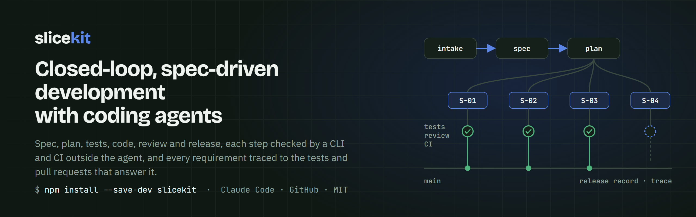

A closed-loop framework for spec-driven development with coding agents.

[](https://www.npmjs.com/package/slicekit)
[](https://github.com/adityapandya1/agentic-slicekit/actions/workflows/slicekit.yml)
[](LICENSE)

## Why

Most agent workflows add control through prompts and rule files, and the agent can skip both.
slicekit checks each step outside the agent: its CLI runs git and refuses a step out of order, its
hooks refuse an edit to a frozen test and check the spec each time the agent finishes a turn, and
CI runs the same checks on every pull request.

## See it in action

The steps of a Claude Code session, from the requirement document to the release. Under each slash
command are lines the kit's commands print for it, taken from two sources named below the block, so
the pull request numbers and hosts differ between steps.

```text
> /slicekit intake brief/orders.md
  ⎿ docs/intake/2026-10-31-orders.md
    D-02
    open: D-09 Which payment provider do refunds go through?

> /slicekit specify
  ⎿ #12 https://github.com/acme/orders/pull/12

> /slicekit gaps
  ⎿ G-3 unknown D-09 is open: Which payment provider do refunds go through?
    D-09
    G-3 closed by D-09
    ready: gap-scan

> /slicekit plan
  ⎿ ready to plan
    D-14
    BUILD.md updated

> /slicekit build P1/S-01
  ⎿ tests-red → building
    #1 https://example.test/pull/1
    next: ci
    rounds: 1 of 2
    ci-green
    ready: waiting for an independent review; run /slicekit review 1 in a new session

> /slicekit review 1
  ⎿ round 2
    verdict …/.slicekit/reviews/P1-S-01i-r2.md
    next: ci
    ci-green
    ready

> /slicekit release P1
  ⎿ docs/releases/P1.md
    released P1/S-01
```

Intake, specify, gaps, plan and release lines are from the examples on the guide's command pages:
intake from `intake`, specify from `pr`, gaps from `gaps` and `decide`, plan from `plan`,
`decide` and the `--write` option of `status`, release from `release`. Build and review lines are from the
walkthrough on `examples/backend`, except the review's `verdict` line: it is the verdict file that
`review start` prints, with the path shortened from the left to `…/`.

## What it covers

| Stage | Command | What you get |
|---|---|---|
| Any | `/slicekit` | any procedure below by name, for example `/slicekit build` |
| Next | `/slicekit next` | the one next step, read from the files, run and then stopped; `/loop /slicekit next` runs one step per iteration, and a person merges |
| Brief | `/slicekit brief` | a brief written from the person's own answers, when there is only an idea and no requirement document |
| Intake | `/slicekit intake` | a frozen snapshot of the requirement document and one decision row per answer |
| Specify | `/slicekit specify` | spec files in which every requirement cites its source, and the spec pull request |
| Gaps | `/slicekit gaps` | each place the spec is silent, vague or in conflict with the intake, asked about and closed |
| Plan | `/slicekit plan` | the stack, the phases and the slice files, and the plan pull request |
| Build | `/slicekit build` | one slice from failing tests to a pull request with a verdict and green CI |
| Review | `/slicekit review` | an independent verdict from a session that holds no context of the build |
| Release | `/slicekit release` | the release record of a phase whose slices are merged, and the release pull request |
| Operate | `/slicekit ops` | the triage of a symptom: the slices that touched its files and the runbook's first checks |
| Audit | `/slicekit audit` | the claims of the spec and the runbook compared with the code, the tests and CI |
| Trace | `slicekit trace`, `slicekit impact`, `slicekit history`, `slicekit uncovered`, `slicekit shipped` | answers from the graph that `slicekit graph` builds from the kit's IDs and git |

## Quick start

In your project, with Node 22 or later and git:

```sh
npm install --save-dev slicekit
npx slicekit init --shape backend --name <your-project>
```

Then open Claude Code in the project and type `/slicekit intake <your requirement document>`. A person with only an idea types
`/slicekit brief` first, then the `/slicekit intake` command it prints. To
see each step run on a sample project first, follow
[the ten-minute walkthrough](https://github.com/adityapandya1/agentic-slicekit/blob/main/docs/walkthrough.md)
from a clone of this repository.

## How it differs

- Prompt and rule-file workflows tell the agent what to do. slicekit refuses the step when the agent does not do it.
- Spec-only tools write the spec and stop. slicekit traces each requirement to its tests, commits, pull requests and releases, and checks the spec again on each turn and in CI.
- With no workflow, the agent's own report is the record. With slicekit the record is the state files and commits that its CLI writes, and the verdict files that the reviewer agent writes and the CLI checks and commits.

## Docs

- [The user guide](https://github.com/adityapandya1/agentic-slicekit/blob/main/docs/guide/README.md) explains the stages and has a page for every `slicekit` command, every `/slicekit` slash command and every check rule. A command's page gives its usage, what it reads and writes, its exit codes and an example. A check rule's page says what fails and the failure the rule prevents.
- [The ten-minute walkthrough](https://github.com/adityapandya1/agentic-slicekit/blob/main/docs/walkthrough.md) builds one slice of `examples/backend` from `todo` to `merged`.
- [The runbook](https://github.com/adityapandya1/agentic-slicekit/blob/main/docs/runbook.md) covers releasing the kit, rolling back a bad version on npm and debugging a hook on Windows.
- [docs/adapters.md](https://github.com/adityapandya1/agentic-slicekit/blob/main/docs/adapters.md) describes the contracts for anyone adding a git host, a tracker or an agent tool.
- [CHANGELOG.md](https://github.com/adityapandya1/agentic-slicekit/blob/main/CHANGELOG.md) lists what each version changed.

<details>
<summary>Status: preview</summary>

Phases 1 to 5 work. Phases 1 and 2 are intake, specify, the gap scan, plan, the build from red
tests to green, the review loop, the independent review and `/slicekit build --parallel`. Phase 3
is the traceability graph (`graph`), its queries (`trace`, `impact`, `history`, `uncovered` and
`shipped`), its views (`visualize`), and workspaces that let the graph span several repositories;
a slice is still built in one repository. Phase 4 is hardening: `check` reads the git host's rules
on the default branch and `init --protect` sets the missing ones, the guards refuse what they
cannot judge, commits to the session journal must be signed, the state change after a merge goes
up as a pull request, and declined should-haves can go to Jira. Phase 5 is `release` (the release
record of a phase), `ops` (the triage of a symptom), `audit` (the claims of the spec and the
runbook against the code), observability steps in CI, and two more examples, `examples/fullstack`
and `examples/data`.

The kit is on npm as a preview from 0.1.1. Versions from 0.3.0 are published from CI, each with a
provenance attestation; the versions before it carry none. It needs Node 22 or later and git, and
it has no dependencies of its own.

Each change to the kit ships as the next 0.x version, and a 0.x version may change how a command
works. After an upgrade, `npx slicekit update` shows what would change in each of the kit's files,
and `npx slicekit update --yes` writes the changes.

The walkthrough runs from a clone instead of an install, because it copies files only the
repository holds (`examples/backend` and `examples/walkthrough`):

```sh
git clone https://github.com/adityapandya1/agentic-slicekit
cd agentic-slicekit
node bin/slicekit.js --version
```

</details>

<details>
<summary>Scope</summary>

The kit does not parse source code. Its graph is built from its own IDs and from git by
`slicekit graph`: requirements, decisions, slices, tests, commits, pull requests and releases. It is
not a code graph: it infers no calls or imports. For a code graph,
[graphify](https://github.com/Graphify-Labs/graphify) or a similar tool sits alongside. This line
installs graphify and its Claude Code skill:

```sh
pip install graphifyy && graphify install
```

Then one Claude Code session runs both: `/graphify .` for the code graph, then `/slicekit build`.

</details>

<details>
<summary>How the hooks find slicekit</summary>

`slicekit init` writes the hook command as `node node_modules/slicekit/bin/slicekit.js` when the
repository has a local install, and `slicekit` otherwise, which needs slicekit on PATH. When neither
is found, init still writes `slicekit` and warns that the hooks will fail until it is installed; it
never fetches slicekit from the registry. `cli` in `.slicekit/config.json` (or `init --cli <command>`)
overrides that choice, and init and update warn when the command does not answer `--version`. The
usual setup is a local install, `npm install --save-dev slicekit`, before init. To run the kit from a clone
instead, pass `--cli` to init, as the walkthrough does:
`--cli "node \"<path-to-kit>/bin/slicekit.js\""`. The
hooks run from the session's working directory, so a worktree outside the repository tree needs an
absolute path in `cli` or a global install.

</details>

<details>
<summary>Built with itself</summary>

The kit is built with itself: every change to `src/`, `bin/` and `templates/` went through a slice,
with tests written first, a review and green CI; its plans and version changes go through pull requests
of their own. Test files have also changed in spec pull requests, and #94 is the one case so far.
`docs/spec/00-overview.md` says what the kit is and why, `docs/decisions.md` holds every
choice made so far, and `BUILD.md` shows the order the kit is built in.

</details>

License: MIT.
